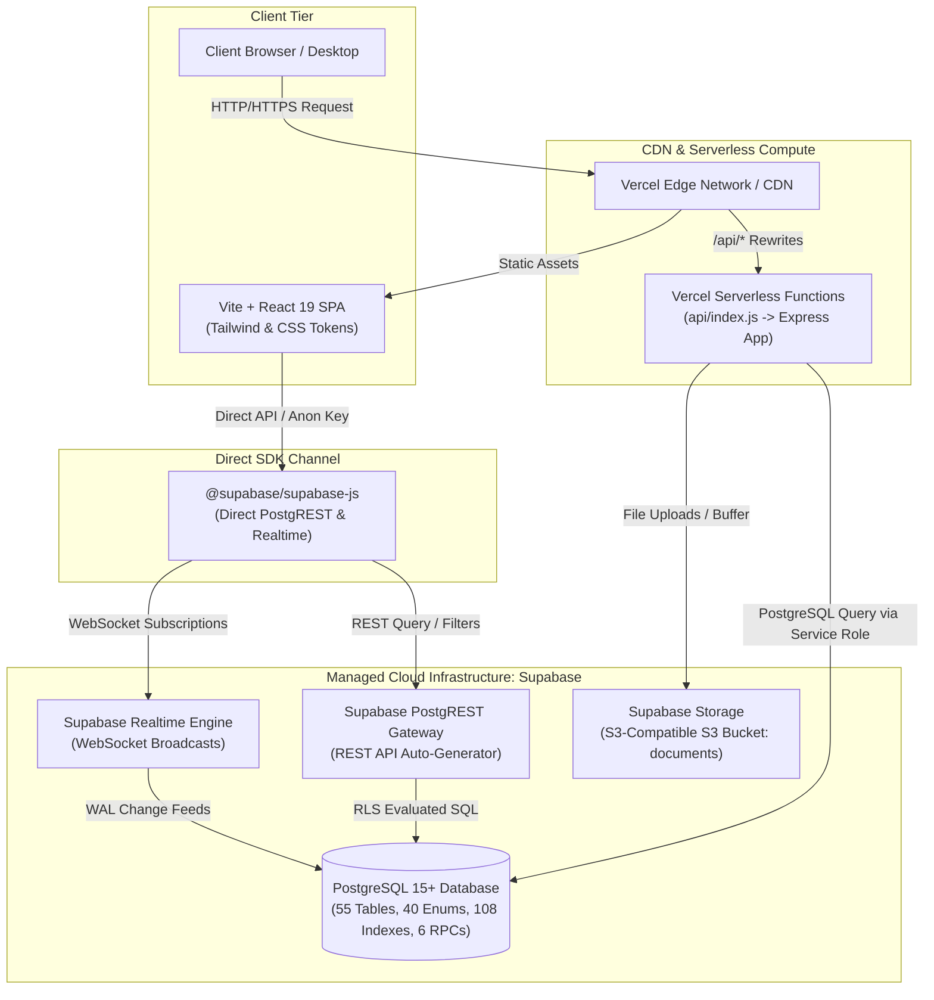
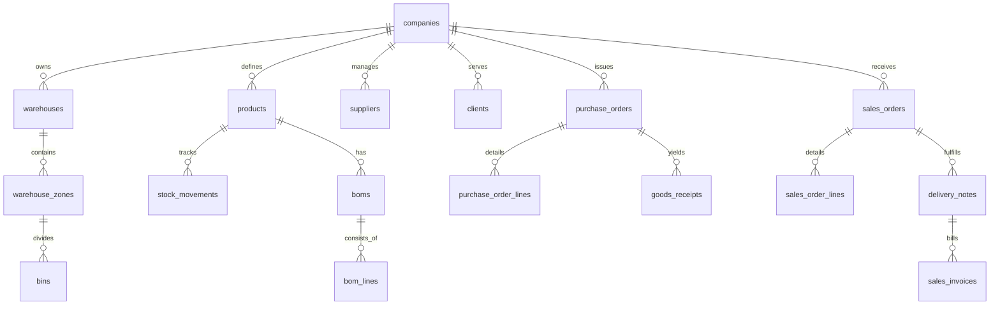

# Dokumentasi Infrastruktur, Skema Basis Data & Spesifikasi Endpoint API
## MOAI Supply Chain Management ERP (v2.0 Enterprise)

Dokumen ini menyediakan spesifikasi teknis arsitektur infrastruktur, representasi skema basis data relasional (PostgreSQL / Supabase), serta dokumentasi endpoint API lengkap dari sistem **MOAI SCM ERP**.

---

## 1. Arsitektur Infrastruktur Sistem

Sistem MOAI SCM ERP mengadopsi pola arsitektur **Hybrid Cloud & Serverless** dengan pemisahan yang jelas antara lapisan presentasi (Frontend), komputasi backend (Express / Vercel Serverless), dan basis data terkelola (Supabase Managed PostgreSQL & Object Storage).



### 1.1 Komponen & File Infrastruktur

| Komponen | File / Konfigurasi | Peran & Tanggung Jawab |
| :--- | :--- | :--- |
| **Serverless Entrypoint** | [`api/index.js`](file:///c:/Users/Nosdovah/Documents/Qulyah/Semester%204/Smart%20Supply%20Chain%20Management/ERP%20Procurement/SCM-ERP/api/index.js) | Adapter Node.js untuk Vercel Serverless Function, mengekspor instance Express `app`. |
| **Server Application** | [`server/server.js`](file:///c:/Users/Nosdovah/Documents/Qulyah/Semester%204/Smart%20Supply%20Chain%20Management/ERP%20Procurement/SCM-ERP/server/server.js) | Server Express.js monolitik yang menangani routing REST `/api/v2/*`, CORS, upload memori, dan fallback offline. |
| **Routing Vercel** | [`vercel.json`](file:///c:/Users/Nosdovah/Documents/Qulyah/Semester%204/Smart%20Supply%20Chain%20Management/ERP%20Procurement/SCM-ERP/vercel.json) | Menentukan aturan *rewrite* agar semua request ke path `/api/(.*)` diteruskan ke serverless runtime `api/index.js`. |
| **Client Frontend** | [`src/App.jsx`](file:///c:/Users/Nosdovah/Documents/Qulyah/Semester%204/Smart%20Supply%20Chain%20Management/ERP%20Procurement/SCM-ERP/src/App.jsx), [`src/components/v2/*`](file:///c:/Users/Nosdovah/Documents/Qulyah/Semester%204/Smart%20Supply%20Chain%20Management/ERP%20Procurement/SCM-ERP/src/components/v2) | Single Page Application (SPA) berbasis React 19 dengan dukungan switching antarmuka V1 dan Enterprise V2. |
| **Koneksi Supabase** | [`src/supabaseClient.js`](file:///c:/Users/Nosdovah/Documents/Qulyah/Semester%204/Smart%20Supply%20Chain%20Management/ERP%20Procurement/SCM-ERP/src/supabaseClient.js) | Inisialisasi `@supabase/supabase-js` menggunakan anon key untuk koneksi langsung browser-ke-database. |
| **Vite Dev Server** | [`vite.config.js`](file:///c:/Users/Nosdovah/Documents/Qulyah/Semester%204/Smart%20Supply%20Chain%20Management/ERP%20Procurement/SCM-ERP/vite.config.js) | Reverse proxy lokal (`/api` diarahkan ke `http://localhost:5000`) saat pengujian dev. |

### 1.2 Variabel Lingkungan (*Environment Variables*)

Konfigurasi disimpan dalam file [`.env`](file:///c:/Users/Nosdovah/Documents/Qulyah/Semester%204/Smart%20Supply%20Chain%20Management/ERP%20Procurement/SCM-ERP/.env) untuk lokal dan *Environment Variables* di Vercel Dashboard:

```env
# URL Project Supabase
VITE_SUPABASE_URL=https://your-project-id.supabase.co

# Public Anon Key (digunakan oleh Client SPA dengan pembatasan RLS)
VITE_SUPABASE_ANON_KEY=your-anon-public-key

# Service Role Key (Opsional untuk Server Backend jika bypass RLS diperlukan)
SUPABASE_SERVICE_ROLE_KEY=your-supabase-service-role-key

# Port Server Lokal
PORT=5000
```

---

## 2. Representasi Skema Basis Data (MOAI ERP v2.0)

Skema database diimplementasikan secara komprehensif dalam file [`MOAI_ERP_schema.sql`](file:///c:/Users/Nosdovah/Documents/Qulyah/Semester%204/Smart%20Supply%20Chain%20Management/ERP%20Procurement/SCM-ERP/MOAI_ERP_schema.sql) yang terdiri dari **55 tabel relasional**, **40 tipe PostgreSQL ENUM**, **108 indeks performa**, **3 analytical views**, dan **6 atomic RPC stored procedures**.

### 2.1 Filosofi Desain Basis Data
1. **Multi-Tenancy via `company_id`**: Setiap tabel transaksional mengisolasi data per perusahaan menggunakan foreign key ke `public.companies(id)`.
2. **Immutable Stock Ledger**: Mutasi stok barang dicatat secara permanen pada tabel `stock_movements`. Nilai stok fisik tidak pernah diubah secara manual (`UPDATE`), melainkan dihitung secara agregat (`SUM(qty)`) atau melalui materialized views.
3. **Serial Number Registry**: Pelacakan unit individual ber-serial/IMEI (Laptop, GPU, Motherboard) dari penerimaan barang, perakitan, hingga pengiriman ke klien.
4. **BOM & Assembly Engine**: Dukungan struktur Bill of Materials bersarang dan de-bundling (pembongkaran unit prebuilt kembali ke spare parts).

---

### 2.2 Ringkasan Modul & Tabel Relasional



#### Modul 1: Master Data (10 Tabel)
* `public.companies`: Entitas tenant multi-perusahaan (Tier, status, mata uang dasar).
* `public.company_users`: Relasi akun pengguna, role RBAC (13 peran), dan scope gudang.
* `public.warehouses`: Data fasilitas fisik gudang (Central, Regional, Transit, Project).
* `public.warehouse_zones`: Zona rak (Prebuilt, Barebone, Spare Part, Karantina, RMA).
* `public.bins`: Lokasi rak spesifik dengan batas kapasitas berat dan volume.
* `public.brands`: Data merek produk (ASUS, Lenovo, Intel, NVIDIA, dll).
* `public.products`: Master katalog barang, tipe (Prebuilt, Barebone, Component, Peripheral), unit satuan (UOM), dan status aktif.
* `public.suppliers`: Vendor penyedia barang, kredensial pembayaran, dan kontak.
* `public.clients`: Pelanggan (B2B Corporate, Retail, Education, Enterprise) dan limit kredit.
* `public.product_operational`: Parameter operasional stok (Min/Max stock, Reorder Point, Safety stock, shelf life).

#### Modul 2: Inventory & Assembly Engine (13 Tabel)
* `public.serial_numbers`: Registri serial/IMEI dengan garansi vendor & customer.
* `public.stock_movements`: Buku besar transaksi persediaan (*ledger*) yang tidak dapat dihapus (*immutable*).
* `public.boms` & `public.bom_lines`: Bill of Materials spesifikasi perakitan PC & bundling.
* `public.assembly_orders` & `public.assembly_order_lines`: Perintah kerja teknisi untuk perakitan PC prebuilt.
* `public.stock_transfers` & `public.stock_transfer_lines`: Mutasi antar-gudang atau antar-rak fisik.
* `public.stock_adjustments` & `public.stock_adjustment_lines`: Koreksi selisih stok (rusak, hilang, penyesuaian audit).
* `public.stock_opname_sessions` & `public.stock_opname_lines`: Sesi audit fisik stok gudang berkala.
* `public.assets`: Aset internal perusahaan non-dagang (alat uji, perkakas perakitan).

#### Modul 3: RMA & Quality Control (4 Tabel)
* `public.rma_cases` & `public.rma_lines`: Tiket klaim retur/garansi dari pelanggan.
* `public.qc_inspections` & `public.qc_inspection_lines`: Hasil inspeksi mutu barang masuk (GRN) atau hasil rakitan teknisi.

#### Modul 4: Supply Chain Management (SCM) & Inbound (10 Tabel)
* `public.purchase_requisitions` & `public.purchase_requisition_lines`: Permintaan pembelian internal dari divisi operasional.
* `public.purchase_orders` & `public.purchase_order_lines`: Pesanan pembelian resmi ke supplier/vendor.
* `public.goods_receipts` & `public.goods_receipt_lines`: Bukti penerimaan barang fisik di gudang (Surat Penerimaan Barang).
* `public.vendor_price_lists` & `public.vendor_price_history`: Katalog harga vendor dan histori pergerakan harga beli.
* `public.rtv_cases` & `public.rtv_lines`: Retur ke vendor (*Return to Vendor*) atas barang cacat pabrik (DOA).

#### Modul 5: Outbound, Sales & Fulfillment (8 Tabel)
* `public.sales_orders` & `public.sales_order_lines`: Pesanan penjualan pelanggan dengan alokasi stok.
* `public.pick_tasks` & `public.pick_lines`: Tugas pemungutan barang di gudang berdasarkan rak spesifik (*Picking List*).
* `public.pack_tasks` & `public.pack_lines`: Tugas pengemasan barang, verifikasi nomor seri, dan penimbangan paket.
* `public.delivery_notes` & `public.delivery_note_lines`: Surat Jalan (SJ) pengiriman barang keluar gudang.

#### Modul 6: Finance & Costing (9 Tabel)
* `public.currencies` & `public.exchange_rates`: Master mata uang dan kurs pertukaran harian.
* `public.sales_invoices`: Faktur tagihan piutang dagang (AR) ke klien.
* `public.ap_bills`: Tagihan utang dagang (AP) dari vendor atas penerimaan barang.
* `public.payments`: Catatan transaksi pembayaran masuk (AR) atau keluar (AP).
* `public.cogs_records`: Kalkulasi Harga Pokok Penjualan (HPP / COGS) per transaksi penjualan.
* `public.service_tickets` & `public.service_ticket_parts`: Tiket layanan perbaikan dan penggunaan suku cadang teknisi.
* `public.lsp_billings`: Rekapitulasi biaya logistik pihak ketiga (3PL / ekspedisi).

#### Modul 7: Worker Performance (1 Tabel)
* `public.worker_activities`: Audit log pelacakan KPI durasi kerja karyawan (Picking, Packing, Assembly, QC).

---

### 2.3 Real-Time Views & Prosedur Tersimpan (Stored Procedures / RPC)

#### Analytical Views
1. **`public.stock_balances`**: Menampilkan posisi stok aktual *real-time* per kombinasi produk, gudang, dan rak yang dihitung dari agregasi `stock_movements`.
2. **`public.stock_aging`**: Klasifikasi umur persediaan (0–30 hari, 31–60 hari, 61–90 hari, >90 hari) untuk deteksi barang *dead-stock*.
3. **`public.product_price_view`**: Tampilan harga jual efektif berdasarkan tingkatan kuantitas dan mata uang.

#### Prosedur Transaksional Atomik (RPC)
Operasi bisnis kritis dijalankan secara transaksional di level PostgreSQL (`BEGIN ... COMMIT`) untuk menjamin konsistensi data:

| Prosedur RPC | Parameter Utama | Efek Transaksi |
| :--- | :--- | :--- |
| `public.rpc_post_grn` | `p_gr_id`, `p_actor`, `p_idempotency_key` | Memposting penerimaan barang, menambah saldo di `stock_movements`, meregistrasi nomor seri, dan mengubah status PO menjadi `PARTIALLY_RECEIVED` / `RECEIVED`. |
| `public.rpc_execute_assembly` | `p_asm_id`, `p_actor`, `p_idempotency_key` | Mengurangi stok komponen rakitan (CPU, RAM, GPU) sesuai BOM, dan menerbitkan stok unit jadi (Prebuilt PC) ber-serial baru. |
| `public.rpc_debundle` | `p_asm_id`, `p_actor`, `p_idempotency_key` | Membalik proses rakitan (pembongkaran unit PC), memusnahkan nomor seri unit jadi dan mengembalikan komponen ke rak gudang. |
| `public.rpc_transfer_stock` | `p_trf_id`, `p_actor`, `p_idempotency_key` | Memindahkan persediaan antar-gudang atau antar-bin secara atomik (mengurangi gudang asal dan menambah gudang tujuan). |
| `public.rpc_allocate_so` | `p_so_id` | Mengunci (*reserve*) stok fisik untuk pesanan penjualan berdasarkan strategi FIFO / FEFO. |
| `public.rpc_ship_order` | `p_sj_id`, `p_actor`, `p_idempotency_key` | Memposting Surat Jalan, mengurangi stok fisik di buku besar persediaan, dan memperbarui status SO ke `SHIPPED`. |

---

## 3. Representasi Endpoint API

Arsitektur aplikasi menyediakan dua lapisan interaksi API:
1. **Lapisan 1: REST API Backend (Express / Vercel Serverless)** di path `/api/*`
2. **Lapisan 2: Direct PostgREST API (Supabase Gateway)** di path `https://<supabase-url>/rest/v1/*`

---

### 3.1 Lapisan 1: Express / Vercel REST API (`/api/*`)

#### A. Health & Autentikasi
| Method | Endpoint | Deskripsi | Request Body Contoh | Status Response |
| :--- | :--- | :--- | :--- | :--- |
| `GET` | `/api/health` | Status server & konektivitas DB | - | `200 OK` |
| `POST` | `/api/auth/login` | Login user & dapatkan session | `{"email": "user@moai.com", "password": "SecretPassword"}` | `200 OK` / `400 Bad Request` |
| `POST` | `/api/auth/register` | Pendaftaran akun & tenant | `{"email": "...", "password": "...", "company_name": "...", "role": "ADMIN"}` | `201 Created` |
| `POST` | `/api/auth/logout` | Revoke session aktif | - | `200 OK` |
| `GET` | `/api/auth/me` | Profil pengguna saat ini | Header `Authorization: Bearer <token>` | `200 OK` / `401 Unauthorized` |

#### B. Master Data v2 (`/api/v2/master/*`)
| Method | Endpoint | Deskripsi | Query / Body |
| :--- | :--- | :--- | :--- |
| `GET` | `/api/v2/master/products` | Daftar produk katalog | `?category=PREBUILT&is_active=true` |
| `POST` | `/api/v2/master/products` | Tambah SKU/produk baru | `{"sku": "PB-INTEL-I9", "name": "Workstation i9", "type": "prebuilt", "uom": "unit"}` |
| `GET` | `/api/v2/master/warehouses` | Daftar fasilitas gudang | - |
| `GET` | `/api/v2/master/zones` | Daftar zona rak gudang | `?warehouse_id=<uuid>` |
| `GET` | `/api/v2/master/bins` | Daftar slot bin fisik | `?zone_id=<uuid>` |
| `POST` | `/api/v2/master/bins` | Tambah slot bin rak baru | `{"code": "BIN-A-01", "zone_id": "<uuid>", "max_weight": 50}` |
| `GET` | `/api/v2/master/brands` | Daftar merek | - |
| `GET` | `/api/v2/master/suppliers` | Data vendor & supplier | - |
| `POST` | `/api/v2/master/suppliers` | Tambah vendor baru | `{"name": "PT ASUS Indonesia", "code": "SUP-ASUS"}` |
| `GET` | `/api/v2/master/clients` | Daftar klien B2B / retail | - |

#### C. Inventory & Assembly v2 (`/api/v2/inventory/*` & `/api/v2/assembly/*`)
| Method | Endpoint | Deskripsi | Parameter & Payload |
| :--- | :--- | :--- | :--- |
| `GET` | `/api/v2/inventory/balances` | Saldo stok per gudang & bin | `?warehouse_id=<uuid>&product_id=<uuid>` |
| `GET` | `/api/v2/inventory/movements` | Riwayat buku besar stok (ledger) | `?limit=50&product_id=<uuid>` |
| `POST` | `/api/v2/inventory/movements` | Buat mutasi persediaan manual | `{"product_id": "...", "warehouse_id": "...", "movement_type": "MANUAL_ADJUSTMENT", "qty": 5}` |
| `GET` | `/api/v2/inventory/serials` | Daftar serial/IMEI terdaftar | `?status=IN_STOCK` |
| `GET` | `/api/v2/inventory/serials/:no` | Detail riwayat garansi serial | Param `:no` (e.g. `SN-ARES-0012`) |
| `POST` | `/api/v2/inventory/transfers` | Draft transfer antar-gudang | `{"from_warehouse": "...", "to_warehouse": "...", "lines": [...]}` |
| `GET` | `/api/v2/inventory/aging` | Data umur stok (dead stock) | `?days_threshold=60` |
| `GET` | `/api/v2/assembly/boms` | Daftar struktur Bill of Materials | `?product_id=<uuid>` |
| `POST` | `/api/v2/assembly/orders` | Perintah kerja perakitan baru | `{"bom_id": "...", "qty": 10, "warehouse_id": "..."}` |
| `PATCH` | `/api/v2/assembly/orders/:id/complete` | Selesaikan perintah perakitan | Menyimpan nomor seri baru yang dihasilkan |

#### D. Supply Chain Management (SCM) v2 (`/api/v2/scm/*`)
| Method | Endpoint | Deskripsi | Parameter & Payload |
| :--- | :--- | :--- | :--- |
| `GET` | `/api/v2/scm/purchase-orders` | Daftar PO ke supplier | `?status=ORDERED` |
| `POST` | `/api/v2/scm/purchase-orders` | Buat Purchase Order baru | `{"supplier_id": "...", "items": [{"product_id": "...", "qty": 20, "unit_price": 1500000}]}` |
| `PATCH` | `/api/v2/scm/purchase-orders/:id/status` | Ubah status PO | `{"status": "CONFIRMED"}` |
| `GET` | `/api/v2/scm/requisitions` | Permintaan pembelian (PR) | - |
| `POST` | `/api/v2/scm/requisitions/:id/convert` | Konversi PR menjadi PO | - |
| `GET` | `/api/v2/scm/goods-receipts` | Bukti penerimaan barang (GRN) | - |
| `POST` | `/api/v2/scm/goods-receipts` | Rekam dokumen penerimaan barang | `{"po_id": "...", "warehouse_id": "...", "items": [...]}` |
| `GET` | `/api/v2/scm/qc-inspections` | Antrian inspeksi mutu QC | `?status=PENDING` |
| `POST` | `/api/v2/scm/qc-inspections/:id/action` | Putusan QC (Pass/Reject) | `{"passed_qty": 18, "rejected_qty": 2, "defect_reason": "DOA"}` |

#### E. Outbound & Fulfillment v2 (`/api/v2/outbound/*`)
| Method | Endpoint | Deskripsi | Parameter & Payload |
| :--- | :--- | :--- | :--- |
| `GET` | `/api/v2/outbound/sales-orders` | Daftar pesanan penjualan klien | `?status=ALLOCATED` |
| `POST` | `/api/v2/outbound/sales-orders` | Buat Sales Order (SO) baru | `{"client_id": "...", "items": [...]}` |
| `GET` | `/api/v2/outbound/pick-tasks` | Daftar tugas picking petugas | `?warehouse_id=<uuid>` |
| `POST` | `/api/v2/outbound/pick-tasks/wave` | Rilis tugas wave picking | `{"so_ids": ["uuid1", "uuid2"]}` |
| `GET` | `/api/v2/outbound/delivery-notes`| Daftar Surat Jalan (SJ) | - |
| `POST` | `/api/v2/outbound/delivery-notes`| Buat Surat Jalan pengiriman | `{"so_id": "...", "courier": "JNE Cargo", "tracking_no": "..."}` |

#### F. Finance, Costing & Managerial v2 (`/api/v2/finance/*` & `/api/v2/managerial/*`)
| Method | Endpoint | Deskripsi |
| :--- | :--- | :--- |
| `GET` | `/api/v2/finance/cogs` | Laporan rekonsiliasi HPP / COGS per produk |
| `GET` | `/api/v2/finance/ap-bills` | Daftar tagihan utang dagang vendor |
| `POST` | `/api/v2/finance/ap-bills/:id/pay` | Pembayaran utang dagang |
| `GET` | `/api/v2/finance/ar-invoices` | Faktur piutang dagang penjualan |
| `POST` | `/api/v2/finance/ar-invoices/:id/pay` | Penerimaan pembayaran piutang |
| `GET` | `/api/v2/managerial/executive-dashboard` | Ringkasan metrik eksekutif (Nilai stok total, penjualan, efisiensi) |
| `GET` | `/api/v2/managerial/worker-performance` | Metrik KPI efisiensi pekerja per jam |
| `GET` | `/api/v2/managerial/pnl` | Simulasi Laba Rugi operasional berjalan |

#### G. Atomic RPC Wrappers (`/api/v2/rpc/*`)
| Method | Endpoint | Prosedur PostgreSQL yang Dipanggil |
| :--- | :--- | :--- |
| `POST` | `/api/v2/rpc/post-grn` | `public.rpc_post_grn(p_gr_id, p_actor, p_idempotency_key)` |
| `POST` | `/api/v2/rpc/execute-assembly` | `public.rpc_execute_assembly(p_asm_id, p_actor, p_idempotency_key)` |
| `POST` | `/api/v2/rpc/debundle` | `public.rpc_debundle(p_asm_id, p_actor, p_idempotency_key)` |
| `POST` | `/api/v2/rpc/transfer-stock` | `public.rpc_transfer_stock(p_trf_id, p_actor, p_idempotency_key)` |
| `POST` | `/api/v2/rpc/allocate-so` | `public.rpc_allocate_so(p_so_id)` |
| `POST` | `/api/v2/rpc/ship-order` | `public.rpc_ship_order(p_sj_id, p_actor, p_idempotency_key)` |

---

### 3.2 Lapisan 2: Direct PostgREST API (Supabase Gateway)

PostgREST secara otomatis mengekspos seluruh tabel dan *view* di skema `public` ke antarmuka RESTful.

* **Base URL**: `https://<PROJECT-ID>.supabase.co/rest/v1/<table_name>`
* **Header Wajib**:
  ```http
  apikey: <SUPABASE_ANON_KEY>
  Authorization: Bearer <SUPABASE_ANON_KEY_OR_USER_TOKEN>
  Content-Type: application/json
  ```

#### Sintaks Filter Query String
| Operator | Contoh Query Parameter | Makna SQL |
| :--- | :--- | :--- |
| **Pilih Kolom** | `?select=id,code,name,product_operational(*)` | `SELECT id, code, name ... JOIN product_operational` |
| **Sama Dengan (`eq`)** | `?status=eq.IN_STOCK` | `WHERE status = 'IN_STOCK'` |
| **Tidak Sama Dengan (`neq`)** | `?movement_type=neq.SCRAP` | `WHERE movement_type <> 'SCRAP'` |
| **Lebih Besar / Kecil** | `?qty=gte.10&qty=lte.100` | `WHERE qty >= 10 AND qty <= 100` |
| **In List (`in`)** | `?category=in.(PREBUILT,BAREBONE)` | `WHERE category IN ('PREBUILT', 'BAREBONE')` |
| **Pengurutan (`order`)** | `?order=created_at.desc` | `ORDER BY created_at DESC` |
| **Pagination** | `?limit=25&offset=50` | `LIMIT 25 OFFSET 50` |

#### Pemanggilan Stored Procedure via PostgREST
Eksekusi RPC dapat dipanggil secara langsung menggunakan method `POST`:
```http
POST https://<PROJECT-ID>.supabase.co/rest/v1/rpc/rpc_post_grn
apikey: <SUPABASE_ANON_KEY>
Authorization: Bearer <USER_JWT_TOKEN>
Content-Type: application/json

{
  "p_gr_id": "c71a396e-5264-4b53-b09e-761350a8c2f1",
  "p_actor": "3a0b171c-3642-4f0f-876a-54ff29092451",
  "p_idempotency_key": "IDEM-GRN-2026-001"
}
```

---

## 4. Panduan Diagnostik & Error Handling

### Mengapa Mendapat `404 Not Found (PGRST205)`?
Jika Anda memanggil:
```http
GET https://bwtlvutgkqvsduvefdkl.supabase.co/rest/v1/orders
GET https://bwtlvutgkqvsduvefdkl.supabase.co/rest/v1/order_history
```
Dan mendapatkan respons:
```json
{
  "code": "PGRST205",
  "message": "Could not find the table 'public.orders' in the schema cache",
  "hint": "Perhaps you meant the table 'public.sales_orders'"
}
```

**Penyebab**:
* Supabase PostgREST mencari tabel `public.orders` dan `public.order_history` pada *schema cache* PostgreSQL.
* Proyek telah dimigrasikan ke **MOAI ERP v2.0**, di mana konsep pesanan telah dipecah menjadi `sales_orders` dan `purchase_orders`.
* Jika ingin tetap mendukung fitur Kanban Board v1 dan audit log v1 tanpa mengubah frontend, jalankan DDL pembuatan tabel pendamping dari [`supabase_schema.sql`](file:///c:/Users/Nosdovah/Documents/Qulyah/Semester%204/Smart%20Supply%20Chain%20Management/ERP%20Procurement/SCM-ERP/supabase_schema.sql) di SQL Editor Supabase.
